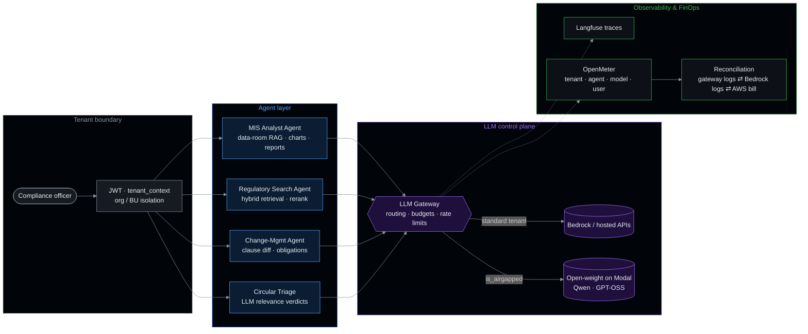

<div align="center">


<a href="https://git.io/typing-svg"></a>

<br/>

<a href="https://www.linkedin.com/in/aviral31/"></a>
<a href="https://x.com/aviralsharma_"></a>
<a href="mailto:aviralsharma5531@gmail.com"></a>


</div>

<br/>

> I build **LLM agents that survive production** — stateful, tool-using systems wrapped in deterministic
> control planes: tenant isolation, budget enforcement, audit trails, evals and traces.
> Currently an **AI Engineer at [OnFinance AI](https://onfinance.ai)**, building **ComplianceOS** — an agentic
> compliance platform for banks, NBFCs and regulators in India.

<br/>

## ◆ `agent.yaml`

```yaml
apiVersion: agents/v1
kind: Engineer
metadata:
  name: aviral-sharma
  org: onfinance-ai
  education: B.Tech IT, ABESIT (2024)
spec:
  runtime:       [LangGraph, LangChain, tool-calling, structured outputs, MCP]
  models:        [Claude via Bedrock, GPT, Qwen, GPT-OSS, Llama, Groq, Ollama]
  serving:       [LLM gateway (Bifrost), Modal, AWS Bedrock, self-hosted open-weight]
  retrieval:     [hybrid search, dense + sparse embeddings, rerank, OpenSearch, Qdrant, FAISS]
  observability: [Langfuse, OpenMeter, CloudWatch, Grafana]
  invariants:
    - fail closed on unknown state — never guess a tenant, a model, or a price
    - every run has a wall clock; no agent hangs forever
    - validate agent output at write time, not at render time
    - if it isn't metered and traced, it isn't in production
```

<br/>

## ◆ What I've built at OnFinance

<sub><code>220+ merged PRs · platform, infra & deployment repos · Apr 2026 → present</code></sub>



<table>
<tr><th align="left" width="24%">System</th><th align="left">What I shipped</th></tr>

<tr><td valign="top"><b>🧠 Agent runtime</b><br/><sub>MIS analyst agent</sub></td><td>

Conversational analyst agent over a tenant's data room. Ported the agent's tools and categories onto the v1 runtime, restored **semantic retrieval with rerank + chunking**, and grounded quoted figures in **PDFs and scanned docs**. Chart specs are **schema-validated at save time**, so a broken chart can't ship as an empty panel. Hardened the runtime: **a wall clock on every run**, summarisation that **fails open**, a stream guard that no longer races the job document, and an *agent-is-working* state that survives refresh. Full input/output traces in **Langfuse**.

</td></tr>

<tr><td valign="top"><b>🔒 Air-gapped LLM routing</b></td><td>

A per-tenant `is_airgapped` flag, resolved from the tenant registry, sends **all** of that tenant's LLM traffic to **self-hosted open-weight models (Qwen, GPT-OSS on Modal)** through a dedicated gateway key. **Fails closed** on unknown tenants, so no request can quietly fall through to a hosted provider.

</td></tr>

<tr><td valign="top"><b>📊 Token metering & FinOps</b></td><td>

End-to-end usage metering on **OpenMeter**, keyed by **tenant → agent → model → user**. Cache-aware token accounting (prompt-cache reads and writes reported separately), wired into every agent through LLM callbacks, with **hard server-side per-agent budget enforcement** from a UI-configurable control plane. Built a **three-way reconciliation** (gateway logs ⇄ Bedrock invocation logs ⇄ AWS Cost Explorer) and a cost ledger for the whole AWS bill. Found and closed a **460M-token** gap between Postgres and OpenMeter. Settled days are immutable, and backfill ingest is idempotent.

</td></tr>

<tr><td valign="top"><b>📜 Regulatory intelligence</b></td><td>

Pipeline from captured regulator circular to **LLM relevance verdict** (regulator × regulated-entity type) to feed subscriptions to the homepage *Circulars* panel. Event-driven **identity Lambda** (EventBridge sweep, VPC-private, SAM) mints permanent document IDs. The business-logic service owns the search-corpus writes to **OpenSearch**. Public feeds let regulator accounts publish directly.

</td></tr>

<tr><td valign="top"><b>🏢 Multi-tenancy & security</b></td><td>

Shared `tenant_context` library vendored across services. Org and business-unit isolation fences, and **JWT-scoped storage writes** that refuse anything the token can't scope. An S3 re-layout toolkit run and verified on prod. OpenSearch tenant provisioning (shared alias or dedicated index). A hard outbound-LLM block for test accounts, and JWT **signature verification** on chat-context claims.

</td></tr>

<tr><td valign="top"><b>🤖 Agentic operations</b></td><td>

A repo run by agents for the compliance team. An **intent registry** routes every message (continuation / new intent / ambiguous / chat). **Mandatory specialist subagents** handle licence and regulator context, and **multi-agent workflows fan out ~20 agents** to research a regulated business end to end. Clause-by-clause regulatory crosswalks and citation workbooks are generated from the same pipeline.

</td></tr>
</table>

<details>
<summary><b><code>$ git log --oneline --author=aviral</code></b> — a few commit titles</summary>

```text
feat(airgap)     per-tenant is_airgapped flag routes LLM traffic to a Modal-only gateway key
fix(airgap)      registry-resolved flag, fail closed on unknown
fix(agent-v1)    a stuck run can no longer hang forever — summarization fails open, every run has a wall clock
feat(agent)      chart specs are validated at save — a bad chart can never ship as an empty box
fix(mis)         restore semantic retrieval — port rerank + chunk_text
feat(metering)   hard server-side enforcement of per-agent budget allocation
feat(coverage)   cache-aware gateway remainder — matches the AWS invoice
feat(metering)   import Bedrock's invocation log so direct traffic is metered
fix(metering)    never let today's policy erase a settled day's record
feat(identity)   EventBridge-scheduled sweep so nothing in the cluster invokes the resolver
fix(storage)     refuse every tenant-document write the JWT cannot scope
fix(chat)        verify the JWT signature when reading chat context claims
```

</details>

<br/>

## ◆ Open-source agents

<table>
<tr>
<td width="50%" valign="top">

#### [`Trading_agent`](https://github.com/aviralsharmaa/Trading_agent)
Self-improving **LangGraph** state machine:<br/>
`fetch → analyze → plan → simulate → execute → evaluate → learn`<br/>
LLM-generated strategies over technical signals, **backtested before** paper execution on Alpaca. The evaluation node feeds back into the planner.

<sub>LangGraph · Groq · Ollama · Alpaca · FastAPI</sub>

</td>
<td width="50%" valign="top">

#### [`web_wcag_agent`](https://github.com/aviralsharmaa/web_wcag_agent)
Autonomous **WCAG 2.1** auditor. A bounded-BFS crawler on **Playwright** feeds a LangGraph checkpoint evaluator across 4 rule families. Strict-policy verdicts (`Pass / Fail / Cannot verify / N/A`) with DOM-snapshot evidence and a machine-readable report.

<sub>LangGraph · Playwright · Python</sub>

</td>
</tr>
<tr>
<td width="50%" valign="top">

#### [`AI_research_agent`](https://github.com/aviralsharmaa/AI_research_agent)
RAG over research papers: chunking → Sentence-Transformers → **FAISS / Chroma** → a LangGraph agent for grounded QA, summarisation and query-match verdicts.

<sub>LangChain · LangGraph · FAISS · Llama 3.3</sub>

</td>
<td width="50%" valign="top">

#### [`job-mailer`](https://github.com/aviralsharmaa/job-mailer)
Turns a natural-language request into a workflow: intent parsing → domain-matched recipient discovery → compose → dispatch over **Gmail API (OAuth 2.0)**, with attachment support.

<sub>Python · NLP · Gmail API · Streamlit</sub>

</td>
</tr>
<tr>
<td colspan="2" valign="top">

#### 🔍 Vision authentication agents — *production, OneARVO Ventures*
QR + copy-detection-pattern product authentication with **Vision Transformers** and contrastive learning: **97.9 % verification accuracy**. Automated data curation, MLflow tracking, Airflow pipelines, served on SageMaker with Docker/K8s and Grafana monitoring.

<sub>PyTorch · ViT · OpenCV · MLflow · Airflow · SageMaker · Kubernetes</sub>

</td>
</tr>
</table>

<br/>

## ◆ Stack

<div align="center">


<br/>


<br/>


</div>

<br/>

## ◆ Telemetry

<div align="center">


</div>

<br/>

<div align="center">

<sub><code>while not done: state = graph.invoke(state)  # deterministic shell, probabilistic core</code></sub>


</div>
