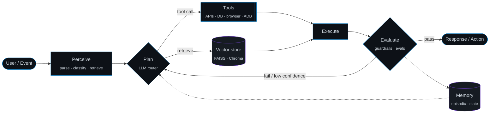

<!-- ─────────────────────────────  HEADER  ───────────────────────────── -->
<div align="center">


<a href="https://git.io/typing-svg"></a>

<p>
  <a href="https://www.linkedin.com/in/aviral31/"></a>
  <a href="https://x.com/aviralsharma_"></a>
  <a href="mailto:aviralsharma5531@gmail.com"></a>
  
</p>

</div>

---

### `$ whoami`

```python
from dataclasses import dataclass, field

@dataclass(frozen=True)
class Engineer:
    name:     str = "Aviral Sharma"
    role:     str = "AI Engineer @ OnFinance AI"
    location: str = "Bengaluru, IN"
    edu:      str = "B.Tech, Information Technology — ABESIT ('24)"

    focus: tuple = (
        "Agentic systems  → stateful graphs, tool-calling, planning, memory",
        "LLM infra        → gateways, routing, self-hosted open-weight models",
        "Retrieval        → hybrid RAG, embeddings, rerankers, evals",
        "MLOps            → reproducible pipelines, tracking, drift, CI/CD",
    )

    now: tuple = (
        "Shipping an LLM-native compliance OS for regulated BFSI institutions",
        "Multi-tenant, audit-grade platform with air-gapped model deployments",
        "Serving open-weight LLMs (Qwen, GPT-OSS) behind a unified LLM gateway",
    )

    principles: tuple = (
        "Deterministic orchestration around non-deterministic models",
        "If it isn't evaluated, it isn't shipped",
        "Observability first: every token traceable, every action auditable",
    )
```

---

### `$ cat architecture.md` — how I build agents



---

### `$ ls ~/projects --featured`

<table>
<tr>
<td width="50%" valign="top">

#### 📈 [Autonomous Trading Agent](https://github.com/aviralsharmaa/Trading_agent)
Self-improving **LangGraph** agent with a 7-node stateful workflow:

`Fetch → Analyze → Plan → Simulate → Execute → Evaluate → Learn`

LLM-generated strategies over technical signals (RSI, MAs, volatility), backtested on historical data before paper execution via **Alpaca**. Post-trade evaluation feeds back into the planner.

<sub>`Python` `LangGraph` `Groq` `Ollama` `Alpaca` `FastAPI` `Streamlit`</sub>

</td>
<td width="50%" valign="top">

#### ♿ [WCAG Accessibility Agent](https://github.com/aviralsharmaa/web_wcag_agent)
Autonomous **WCAG 2.1** auditor. Bounded-BFS crawler (`max_depth`, `max_pages`) with **Playwright**, checkpoint evaluation orchestrated by **LangGraph** across 4 rule buckets, strict-policy verdicts and evidence artifacts (DOM snapshots, `scan-report.json`).
Mobile sibling: [wcag-app-agent](https://github.com/aviralsharmaa/wcag-app-agent) — FastAPI coordinator + worker CLI, Appium runtime, Langfuse tracing.

<sub>`Python` `LangGraph` `Playwright` `Appium` `FastAPI` `Langfuse`</sub>

</td>
</tr>
<tr>
<td width="50%" valign="top">

#### 📱 [Mobile Automation Agent](https://github.com/aviralsharmaa/mobile-automation-agent)
Voice-driven agent that operates Android devices for blind users. **STT → GPT-4o vision** screen grounding → action planning → **ADB** execution → **TTS** feedback, with popup/UI-drift recovery and secure credential handling.

<sub>`Python` `GPT-4o Vision` `ADB` `Speech I/O`</sub>

</td>
<td width="50%" valign="top">

#### 🔍 Vision Authentication Agents — *production*
QR + copy-detection-pattern (CDP) product authentication using **Vision Transformers** and contrastive learning. **97.9%** verification accuracy, automated data curation, **MLflow** tracking, **Airflow** orchestration, served on **SageMaker** with Docker/K8s and Grafana monitoring.

<sub>`PyTorch` `ViT` `OpenCV` `MLflow` `Airflow` `SageMaker` `K8s`</sub>

</td>
</tr>
<tr>
<td width="50%" valign="top">

#### 📚 [AI Research Agent](https://github.com/aviralsharmaa/AI_research_agent)
RAG pipeline over research PDFs: chunking → **Sentence-Transformers** embeddings → **FAISS/ChromaDB** retrieval → LangGraph agent for QA, summarisation and query-match verdicts.

<sub>`LangChain` `LangGraph` `FAISS` `ChromaDB` `Llama 3.3`</sub>

</td>
<td width="50%" valign="top">

#### ✉️ [AI Email Agent](https://github.com/aviralsharmaa/job-mailer)
Natural-language → workflow: `"send a mail to microsoft"` resolves intent, discovers domain-matched recipients, composes and dispatches via **Gmail API (OAuth 2.0)** with attachment support. CLI + Streamlit front-ends.

<sub>`Python` `NLP` `Gmail API` `OAuth 2.0` `Streamlit`</sub>

</td>
</tr>
</table>

---

### `$ cat stack.yaml`

```yaml
llm_and_agents:  [LangGraph, LangChain, OpenAI, Groq, Ollama, HuggingFace, Langfuse]
patterns:        [tool-calling, structured-output, RAG, multi-agent, reflection, guardrails, LLM-as-judge]
ml_dl:           [PyTorch, TensorFlow, scikit-learn, Vision Transformers, contrastive learning, time-series]
retrieval:       [FAISS, ChromaDB, Sentence-Transformers, embeddings, semantic search]
mlops:           [MLflow, Airflow, Docker, Kubernetes, GitHub Actions, Grafana]
cloud:           [AWS: {SageMaker, EKS, Lambda, EC2, S3, CloudWatch}, GCP: {Cloud Run, Artifact Registry, GCS}]
backend:         [FastAPI, Flask, REST, OAuth2, InfluxDB, Playwright, Appium]
frontend_mobile: [TypeScript, Flutter/Dart, Kotlin, C/C++]
```

<div align="center">


<br/>


</div>

---

### `$ git log --stat --author=aviralsharmaa`

<div align="center">


</div>

---

<div align="center">

<sub><code>while (true) { perceive(); reason(); act(); learn(); }</code></sub>


</div>
